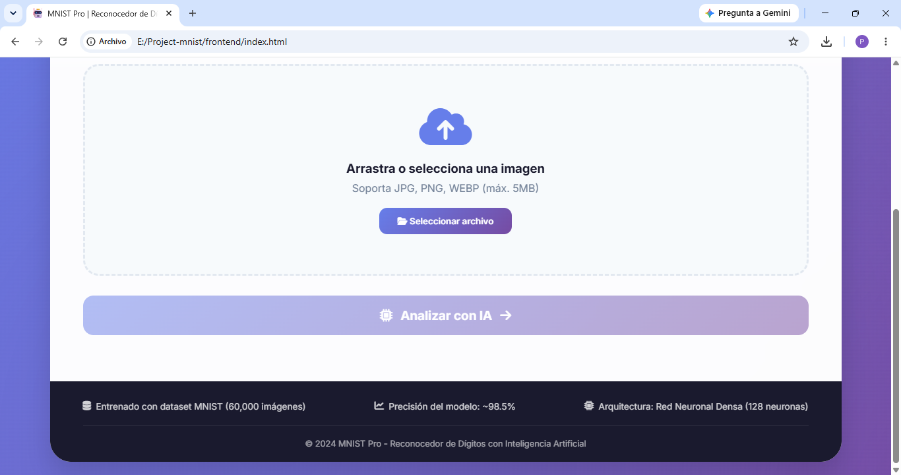
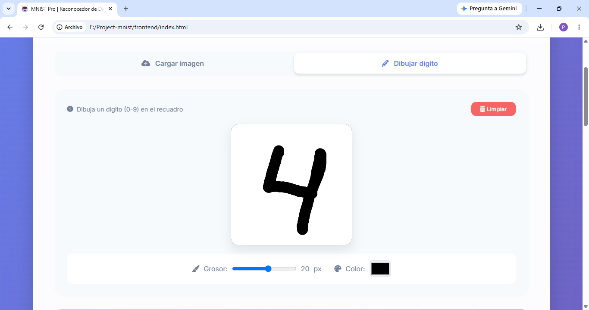
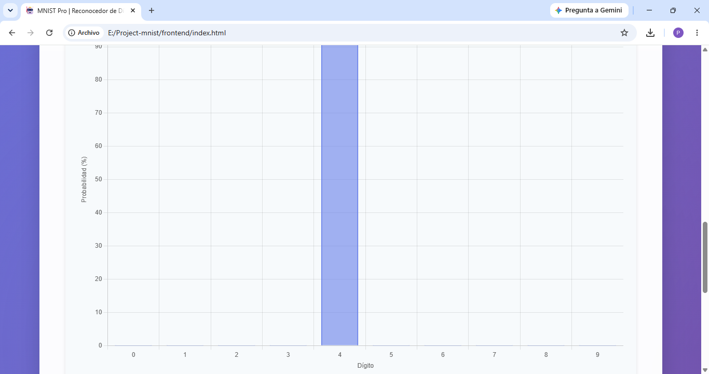

# 🔢 MNIST Pro — Reconocedor de Dígitos con IA

Aplicación web que reconoce dígitos escritos a mano (0–9). Una **red neuronal convolucional** entrenada con el dataset MNIST se expone mediante una **API REST con FastAPI**, y una interfaz web permite **subir una imagen** o **dibujar el dígito** directamente en un lienzo para obtener la predicción con su nivel de confianza.

---

## ✨ Características

- **Modelo CNN** (Keras / TensorFlow) con tres bloques convolucionales, Batch Normalization y Dropout.
- **API REST** con FastAPI: recibe una imagen y responde con la clase predicha, la probabilidad y las probabilidades de los 10 dígitos.
- **Interfaz web** con dos modos de entrada:
  - Subir o arrastrar una imagen.
  - Dibujar el dígito en un lienzo (mouse o pantalla táctil).
- **Visualización de resultados:** gráfica de probabilidades por dígito, top 3 de predicciones y exportación de resultados.
- **Contenedor Docker** para levantar la API sin instalar dependencias.

---

## 🧠 El modelo

El repositorio incluye dos versiones del modelo en `api/model/`:

| Modelo | Arquitectura | Uso |
| ------ | ------------ | --- |
| `modelo_mnistv2.keras` | Red densa: `Flatten` → `Dense(128, ReLU)` → `Dense(10, softmax)` | Versión inicial |
| `modeloV3.keras` | **CNN** (versión que usa la API) | Versión final |

**Arquitectura de `modeloV3`** (entrada 28×28×1):

1. `Conv2D(32, 3×3)` + BatchNorm + ReLU → `MaxPooling2D` → `Dropout(0.2)`
2. `Conv2D(64, 3×3)` + BatchNorm + ReLU → `MaxPooling2D` → `Dropout(0.3)`
3. `Conv2D(128, 3×3)` + BatchNorm + ReLU → `Dropout(0.4)`
4. `GlobalAveragePooling2D`
5. `Dense(256)` + BatchNorm + ReLU → `Dropout(0.5)`
6. `Dense(10, softmax)`

Compilado con el optimizador **Adam**, pérdida `sparse_categorical_crossentropy` y métrica `accuracy`.

### 📊 Resultados

Evaluación de ambos modelos sobre el **conjunto de prueba estándar de MNIST (10,000 imágenes)**:

| Modelo | Parámetros | Precisión |
| ------ | ---------- | --------- |
| `modelo_mnistv2.keras` (red densa) | 101,770 | 97.31 % |
| `modeloV3.keras` (CNN) | 129,962 | **99.17 %** |

Pasar de una red densa a una CNN con Batch Normalization y Dropout redujo los errores de 269 a 83 imágenes de las 10,000.

---

## 🔌 API

| Método | Ruta | Descripción |
| ------ | ---- | ----------- |
| `GET` | `/` | Información de la API |
| `GET` | `/health` | Estado del servicio y del modelo |
| `POST` | `/predict` | Recibe una imagen (`file`) y devuelve la predicción |

**Preprocesamiento de la imagen:** conversión a escala de grises → redimensionado a 28×28 → normalización a [0, 1] → inversión de colores (MNIST usa trazo claro sobre fondo oscuro).

**Ejemplo de respuesta de `/predict`:**

```json
{
  "clase": "7",
  "probabilidad": 0.99,
  "todas_probabilidades": [0.0, 0.0, 0.0, 0.0, 0.0, 0.0, 0.0, 0.99, 0.0, 0.0]
}
```

La documentación interactiva (Swagger UI) queda disponible en `http://127.0.0.1:8000/docs`.

---

## 📸 Capturas








---

## 🚀 Cómo ejecutarlo

### 1. Clonar el repositorio

```bash
git clone https://github.com/KPVE2004/mnist-digit-recognizer.git
cd mnist-digit-recognizer
```

### 2. Levantar la API

**Opción A — Local (Python 3.12):**

```bash
cd api
python -m venv venv
venv\Scripts\activate          # En macOS/Linux: source venv/bin/activate
pip install -r requirements.txt
uvicorn main:app --reload
```

**Opción B — Docker:**

```bash
cd api
docker build -t mnist-api .
docker run -p 8000:8000 mnist-api
```

La API quedará en `http://127.0.0.1:8000`.

### 3. Abrir la interfaz

Con la API corriendo, abre `frontend/index.html` en el navegador (doble clic, o con la extensión *Live Server* de VS Code).

> La API invierte los colores de la imagen: está pensada para dígitos oscuros sobre fondo claro (como los que se dibujan en el lienzo). Las imágenes de `pruebas/` están en formato MNIST original (trazo claro sobre fondo oscuro), por lo que no dan buenas predicciones con esta interfaz.

---

## 🗂️ Estructura del proyecto

```
├── api/
│   ├── main.py                  # API con FastAPI
│   ├── Dockerfile
│   ├── requirements.txt
│   └── model/
│       ├── modeloV3.keras       # CNN (usada por la API)
│       └── modelo_mnistv2.keras # Red densa (versión inicial)
├── docs/                        # Capturas de la aplicación
├── frontend/
│   ├── index.html
│   ├── style.css
│   └── script.js
└── pruebas/                     # Imágenes de ejemplo
```

---

## 🛠️ Tecnologías

Python 3.12 · TensorFlow / Keras · FastAPI · Uvicorn · NumPy · Pillow · Docker · HTML5 · CSS3 · JavaScript

---

## 👩‍💻 Autora

**Katia Paola Victoria Escalera**